# Booklet document schema ? complete

<!-- Generated by npm run docs:booklet-model; edit document model sources. -->

[Canonical model](model.md) ? [Concrete JSON example](model-document-example.json)

The embedded production content index is accepted. Persistence remains T14 work. Each box is a document boundary or a labeled existing service view; indented objects and arrays belong inside it. There are no separate Subject or Artifact collections. Arrows are cross-document references, not execution order.

All maintained domain document summaries are shown. Economy reuses Unibase; this is not a complete inventory of its internal collections. Later-task proposals and unresolved execution details retain explicit labels.

```mermaid
%%{init: {"theme":"base","themeVariables":{"primaryColor":"#f1f5f9","primaryTextColor":"#172033","primaryBorderColor":"#64748b","lineColor":"#64748b","edgeLabelBackground":"#ffffff"},"flowchart":{"htmlLabels":false,"useMaxWidth":false}}}%%
flowchart TB
  Booklet["Booklet<br/>Accepted boundary; T14 pending<br/>_id / ownerId / title / version<br/>currentProductionId? -&gt; Production<br/>createdAt<br/>deletion {<br/>  deletedAt? / recoverUntil?<br/>  purgeState? / purgedAt?<br/>}"]
  Production["Production<br/>Accepted embedded index; T14 pending<br/>_id / ownerId / bookletId / orderId<br/>sourceProductionId? / lifecycleState<br/>version / createdAt / updatedAt<br/>expiresAt? / closedAt?<br/>currentManifestRevisionId?<br/>brief {<br/>  idea / audience / language {tag, direction}<br/>  characterDescriptions[] / locationDescriptions[]<br/>  visualPreferences<br/>}<br/>creativeConfigSnapshot {<br/>  packageId / packageRevision<br/>  storyPages / includeCover<br/>  maxCharacters / maxLocations<br/>  maxPanelsPerPage / styleSamples<br/>  canvas {width, height, mime} / language<br/>  executionProfile {id, revision}<br/>  repairLimitPerOutput / finiteExecutionLimits<br/>}<br/>subjects[] {<br/>  id / kind / label / pageRole?<br/>  artifacts[] {<br/>    id / kind<br/>    currentRevisionId? / acceptedRevisionId?<br/>  }<br/>}<br/>stageLocks {<br/>  story?, style?, references? {<br/>    operationId / lockedAt / sourceRevisionIds[]<br/>  }<br/>}<br/>mutationLease? {<br/>  runId / leaseOwner / leaseExpiresAt / fence<br/>}<br/>activeRunId?"]
  Artifact_revision["Artifact revision<br/>Accepted separate immutable document; T14 pending<br/>_id / productionId / artifactId / subjectId<br/>kind / ordinal / operationId / createdAt<br/>contentHash / schemaVersion<br/>content { one variant by kind<br/>  concept {title, premise, theme, tone, constraints[]}<br/>  outline {summary, beats[] {id, content}}<br/>  manuscript {units[] {<br/>    id / prose / characterIds[] / locationIds[]<br/>  }}<br/>  description {name, description, continuityRules[]}<br/>  roster {orderedCharacterIds[], orderedLocationIds[]}<br/>  style {direction, palette[], typography, continuity[]}<br/>  reference {description, requiredFeatures[], asset}<br/>  pagePlan {pageSubjectId, role, panels[] {<br/>    id / region {x, y, width, height} / action<br/>    characterIds[] / locationIds[] / manuscriptUnitIds[]<br/>    lettering[] {id, kind, content, speakerId?, placement}<br/>  }}<br/>  pageImage {asset, sourcePlanRevisionId}<br/>  bookManifest {title, language, acceptedSources[], pages[] {<br/>    subjectId / role / position<br/>    imageRevision {id, hash} / asset {id, hash}<br/>    qualityReviewId / approvalDecisionId<br/>  }}<br/>}<br/>sources[] {revisionId, hash, role}<br/>assets[] {assetId, hash, role}<br/>provenance {runId, evidenceIds[]}"]
  Operation["Operation<br/>Contract; persistence details pending<br/>_id / productionId / subjectId / kind / state<br/>idempotencyKey / inputHash / createdAt<br/>funding {kind, orderId?, allocationId?}<br/>repair? {failedReviewId, outputId, ordinal}<br/>result {revisionIds[], assetIds[]}<br/>evidenceIds[]"]
  Execution_attempt["Execution attempt<br/>Proposed separate execution history<br/>_id / operationId / runId / attemptNumber<br/>invocationId / workflowRunId? / publicationId<br/>outcome / startedAt? / completedAt?<br/>Unknown provider outcome requires reconciliation"]
  Run_binding["Run binding<br/>Proposed Unitale link; reuse Unibase Run<br/>productionId / runId / ownerId / orderId<br/>purpose / continuationOfRunId?<br/>publicationIdentity / createdAt / closedAt?"]
  Human_decision["Human decision<br/>Contract; persistence pending<br/>_id / productionId / actorId / runId<br/>submission {formId, submissionId}<br/>action / answerOrInstruction? / submittedAt<br/>targets[] {artifactId, revisionId}<br/>acceptedQuote? {requestId, quoteFingerprint}<br/>reuse? {sourceProductionId, sourceRevisionIds[]}"]
  Revision_request["Revision request<br/>Proposed separate customer request<br/>_id / productionId / decisionId<br/>category / subjectIds[] / instruction<br/>sourceRevisionIds[] / allocationIds[]<br/>idempotencyKey / inputHash / state / createdAt<br/>acceptedQuote {<br/>  fingerprint / expectedProductionVersion<br/>  subjects[] / includedUnits / paidUnits<br/>  extraCredits / termsRevision / expiresAt / acceptedAt<br/>}"]
  Quality_review["Quality review<br/>Contract; separate review history<br/>_id / productionId / targetRevisionId / operationId<br/>policyRevisionId / disposition / createdAt<br/>inputs {assetIdentity, sourceRevisionIdentities[]}<br/>findings[] {code, severity, message, evidenceRefs[]}<br/>evidenceRefs[]"]
  Repair_budget["Repair budget<br/>Proposed separate bounded counters<br/>productionId / outputIdentity / version<br/>failedQualityReviewId / limitSnapshot / usedAttempts<br/>executionBudgetRef / spendingBudgetRef<br/>authorizingOperationId / exhaustedAt?"]
  Run["Run<br/>I: existing Unibase service view<br/>id / ownerId / executionState<br/>Human Input integration {<br/>  request {formId, presentedRevisionIds[], question}<br/>  allowedActions[] / expectedProductionVersion<br/>  state / createdAt / answeredAt?<br/>}<br/>Booklet form metadata is a future integration"]
  Execution_measurement["Execution measurement<br/>I: Unibase; attempt linkage proposed<br/>id / operationId / attemptId? / provider / model?<br/>requestId? / workflowIdentity / publicationIdentity<br/>usage {inputTokens?, outputTokens?, additional[]}<br/>cost {reported?, estimated?, currency?, pricingProvenance?}<br/>timing {queuedAt?, startedAt?, completedAt?}<br/>elapsedMs? / providerDurationMs?<br/>outcome / authority / scope / evidenceRefs[]"]
  Original_asset_receipt["Original asset receipt<br/>Contract; T16 persistence pending<br/>_id / ownerId / productionId / operationId<br/>storageObjectId (private) / sha256 / bytes / mime<br/>dimensions {width, height}<br/>provenance {provider, providerRequestId, evidenceId}<br/>retainedAt"]
  Attachment_receipt["Attachment receipt<br/>Proposed durable attachment step<br/>_id / operationId / assetId / artifactRevisionId<br/>expectedProductionVersion / fencingToken<br/>idempotencyKey / inputHash / state / attachedAt?"]
  Display_derivative["Display derivative<br/>Proposed T16 asset record<br/>_id / originalAssetId / transformVersion<br/>width / height / mime / storageObjectId / sha256"]
  Evidence_reference["Evidence reference<br/>I: Unibase evidence metadata; bytes separate<br/>id / operationId / runId / sha256 / bytes / kind<br/>retention {expiresAt, protectedWhileUnresolved}<br/>Private payload storage; no prompts in product documents"]
  PDF_export["PDF export<br/>Proposed later T23<br/>_id / manifestRevisionId / manifestHash<br/>exportProfileVersion / outputAssetId / state<br/>createdAt / evidenceRef?"]
  Share_grant["Share grant<br/>Proposed later T24<br/>_id / ownerId / bookletId / manifestRevisionId<br/>tokenHash / createdAt / revokedAt?<br/>allowDownloads (default false)"]
  Audit_event["Audit event<br/>Reuse existing authorization and audit<br/>actorId / action / targetIds[] / reason / timestamp<br/>evidenceRefs[]<br/>Ownership checked by services; not a nested ACL copy"]
  Catalog_head["Catalog head<br/>I: commerceCatalogs<br/>_id / revision / publishedRevision / updatedAt<br/>draft { kind, terms, fields? }<br/>kind: purchase, consumption, promotion<br/>terms contain price, credit, channel or allowance data<br/>fields contain validated booklet package configuration"]
  Catalog_version["Catalog version<br/>I: commerceCatalogVersions<br/>_id / catalogId / revision / hash / publishedAt / actorUid<br/>definition {<br/>  purchase {credits, price, currency, channel, billing, expiry}<br/>  consumption {credits, entitlementDays?, allowances[]}<br/>  promotion {code?, dates, eligibility, limits, benefit, duration}<br/>  fields? {booklet package extension}<br/>}<br/>Definition is one kind, not three stored catalogs"]
  Billing_intent["Billing intent<br/>I: billingIntents; subscription lifecycle here<br/>_id / uid / checkoutId / hash<br/>offerId / offerRevision / terms {accepted purchase terms}<br/>state / providerId? / accountBinding<br/>nextTerms? / nextEffectiveAt?<br/>periodEnd? / cancelAtPeriodEnd / createdAt"]
  Verified_payment["Verified payment<br/>I: commerceVerifiedPayments<br/>channel / providerPaymentId / uid / checkoutId<br/>offerId / offerRevision / subscriptionId? / sequence<br/>paidAt / providerPromotionId? / evidenceId / hash"]
  Promotion_reservation["Promotion reservation<br/>I: promotionReservations<br/>id / uid / checkoutId / hash<br/>promotion {accepted snapshot}<br/>offerId / offerRevision / channel / state<br/>expiresAt / subscriptionId? / createdAt / releaseHash?"]
  Wallet["Wallet<br/>I: Unibase wallet<br/>_id / balance / reserved / debt<br/>sequence / revision / updatedAt"]
  Credit_lot["Credit lot<br/>I: creditLots<br/>_id / uid / source / reference<br/>originalCredits / reversedCredits / remaining / reserved<br/>expiresAt? / createdAt"]
  Credit_reservation["Credit reservation<br/>I: generic wallet holds; not booklet charges<br/>_id / uid / amount / status<br/>allocations[] {lotId, amount}<br/>createdAt / expiresAt / managedJobId? / committedCredits?"]
  Ledger_entry["Ledger entry<br/>I: Unibase financial history<br/>_id / uid / sequence / kind / delta / reservedDelta<br/>balanceAfter / reservedAfter / debtAfter<br/>reference / operationId / actorUid? / reason? / timestamp"]
  Consumption_order["Consumption order<br/>I: consumptionOrders<br/>_id<br/>value {id, ownerId, targetId, terms, state}<br/>value {chargedCredits, refundedCredits, chargeLedgerId?}<br/>value {idempotencyKey, inputHash, startedAt?, expiresAt?}<br/>fields {validated product extension snapshot}<br/>locks[] / activeWorkflow?"]
  Entitlement_allocation["Entitlement allocation<br/>I: consumptionAllocations<br/>_id / orderId / ownerId / requestId / subjectId?<br/>category / funding {includedOrdinal? or paidOrderId}<br/>chargeId / revoked / inputHash / createdAt"]
  Consumption_workflow["Consumption workflow<br/>I: consumptionWorkflows<br/>_id / orderId / uid / inputHash / state / jobId? / outcome?"]
  Consumption_charge["Consumption charge<br/>I: consumptionCharges<br/>_id / uid / orderId / kind / amount / refunded / ledgerId?"]
  Provider_action["Provider action<br/>I: billingProviderActions; publication journal<br/>id / subjectId / channel / kind / state<br/>request snapshot / previewHash / providerIds[] / evidenceIds[]<br/>Separate from published application catalog version"]
  Execution_profile["Execution profile<br/>Contract capacity; publication bindings proposed<br/>id / revision / limits {pages, entities, panels, samples}<br/>canvases[] / languages[] / coverSupported<br/>publications {orchestrator, text, image, reviewer}"]
  Quality_policy["Quality policy<br/>Proposed versioned workflow policy<br/>id / revision / reviewerPublication<br/>criteria {lettering, content, continuity, usability}<br/>findingCodes[] / blockingPolicy"]
  Booklet -->|"currentProductionId; one booklet has many productions"| Production
  Production -->|"subjects[].artifacts[] current and accepted revision IDs"| Artifact_revision
  Artifact_revision -->|"productionId plus embedded artifactId and subjectId"| Production
  Artifact_revision -->|"sources[] exact immutable dependencies"| Artifact_revision
  Production -->|"productionId on each operation"| Operation
  Operation -->|"result.revisionIds[]"| Artifact_revision
  Operation -->|"operationId"| Execution_attempt
  Execution_attempt -->|"runId"| Run
  Execution_attempt -->|"per-call measurement linkage proposed"| Execution_measurement
  Run_binding -->|"productionId"| Production
  Run_binding -->|"runId"| Run
  Human_decision -->|"productionId"| Production
  Human_decision -->|"targets[] exact revisions"| Artifact_revision
  Revision_request -->|"decisionId"| Human_decision
  Revision_request -->|"allocationIds[]"| Entitlement_allocation
  Revision_request -->|"authorizes work"| Operation
  Quality_review -->|"targetRevisionId and source identities"| Artifact_revision
  Quality_review -->|"policyRevisionId"| Quality_policy
  Repair_budget -->|"failedQualityReviewId"| Quality_review
  Repair_budget -->|"bounded authorizing operation"| Operation
  Artifact_revision -->|"assets[] and manifest page assets"| Original_asset_receipt
  Attachment_receipt -->|"artifactRevisionId"| Artifact_revision
  Attachment_receipt -->|"assetId"| Original_asset_receipt
  Display_derivative -->|"originalAssetId"| Original_asset_receipt
  Operation -->|"evidenceRefs[]"| Evidence_reference
  Execution_measurement -->|"evidenceRefs[]"| Evidence_reference
  Quality_review -->|"evidenceRefs[]"| Evidence_reference
  PDF_export -->|"exact book-manifest revision"| Artifact_revision
  Share_grant -->|"exact book-manifest revision"| Artifact_revision
  Share_grant -->|"ownership and deletion checks"| Booklet
  Audit_event -->|"audited target identity"| Booklet
  Catalog_head -->|"publishedRevision"| Catalog_version
  Billing_intent -->|"accepted purchase snapshot"| Catalog_version
  Billing_intent -->|"verified payments and renewals"| Verified_payment
  Verified_payment -->|"verified grant"| Credit_lot
  Promotion_reservation -->|"promotion snapshot"| Catalog_version
  Verified_payment -->|"finalizes redemption"| Promotion_reservation
  Credit_lot -->|"account identity"| Wallet
  Credit_reservation -->|"allocations[].lotId"| Credit_lot
  Ledger_entry -->|"account audit trail"| Wallet
  Consumption_order -->|"accepted consumption snapshot"| Catalog_version
  Consumption_order -->|"value.targetId"| Production
  Entitlement_allocation -->|"orderId"| Consumption_order
  Entitlement_allocation -->|"subjectId resolves inside production"| Production
  Consumption_workflow -->|"orderId"| Consumption_order
  Consumption_charge -->|"orderId"| Consumption_order
  Consumption_charge -->|"ledgerId"| Ledger_entry
  Provider_action -->|"catalog publication identity"| Catalog_version
  Production -->|"snapshotted profile identity"| Execution_profile
```

