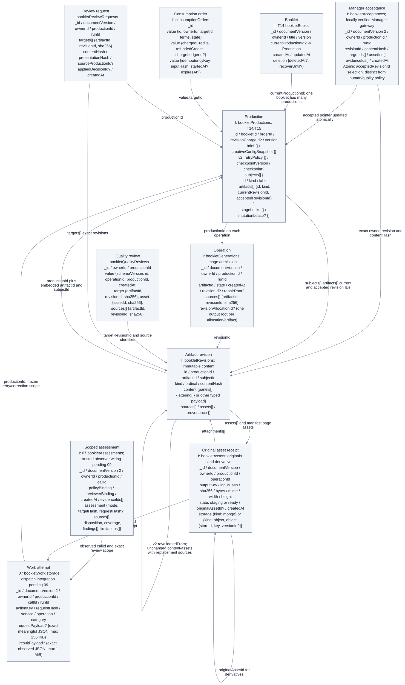

# Booklet document schema ? simple core

<!-- Generated by npm run docs:booklet-model; edit document model sources. -->

[Canonical model](model.md) ? [Concrete JSON example](model-document-example.json)

The embedded production index, lifecycle, media and MCP services are implemented in T14-T17. Later workflow/delivery work retains explicit labels. Each box is a document boundary or a labeled existing service view; indented objects and arrays belong inside it. There are no separate Subject or Artifact collections. Arrows are cross-document references, not execution order.

Core document boundaries and selected nested fields. Complete details: [complete schema](model-complete-mermaid.md).

