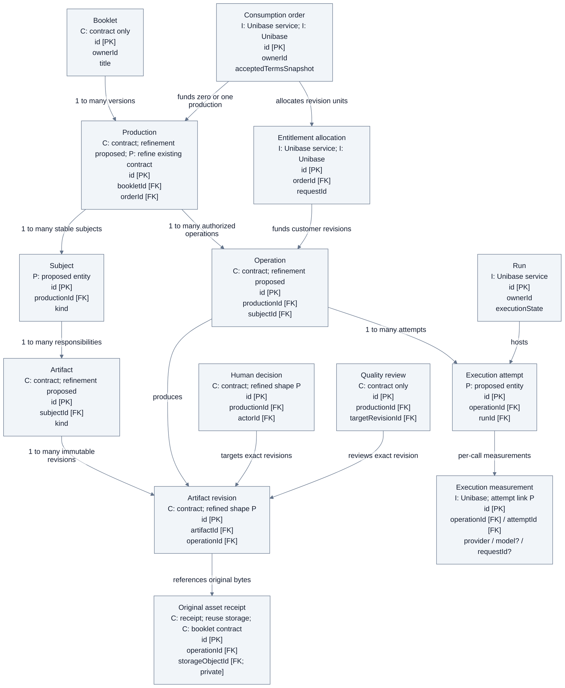

# Booklet schema — simple core

<!-- Generated by npm run docs:booklet-model; edit diagram sources, not this file. -->

[Model guide and decision agenda](model.md) · [Complete review](model-complete-mermaid.md)

Proposed logical schema for T14 review, not an implemented database schema. I = implemented capability, C = contract only, P = proposal. Boxes can represent embedded payloads or service views; they do not imply collections. Arrows name relationships, not execution order or authorization.

Core identities and selected fields only. A completed book is a book-manifest artifact revision; there is no separate Edition collection.

