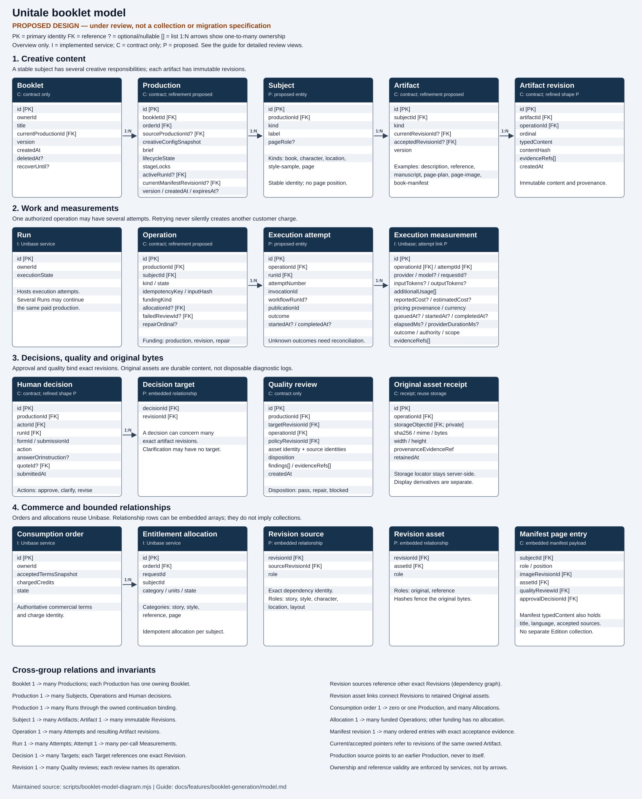

# Booklet model review

## Outcome

Review entities, fields and relationships before implementing T14. The diagram uses
fixed dark text on light rows and light text on dark headers, independent of the
chat or editor theme. Open the SVG directly to zoom without losing detail.

[Open the model diagram](model.svg)

Mermaid versions: [simple core schema](model-core-mermaid.md) and
[complete review schema](model-complete-mermaid.md). Open their Markdown preview
in a Mermaid-capable viewer. The complete version includes every review card and
field summary, grouped by domain; the simple version selects core records and
identity fields. Both use explicit colors for readable labels.



### Detailed review views

| View                                             | Models and fields to discuss                                                                                                                                                                                           | Scope now                                                                                    |
| ------------------------------------------------ | ---------------------------------------------------------------------------------------------------------------------------------------------------------------------------------------------------------------------- | -------------------------------------------------------------------------------------------- |
| [Creative content](model-content.svg)            | Brief, concept, outline, manuscript, individual entities, roster, style, references, panels, lettering and manifest                                                                                                    | T14 identity, revision granularity and typed payload boundaries                              |
| [Lifecycle and revisions](model-lifecycle.svg)   | Production lifecycle, stage locks, mutation lease, Run binding, human requests, revision requests/quotes, reuse acceptance and repair budget                                                                           | Agree durable references and concurrency boundaries; behavior belongs to T15/T20             |
| [Economy and configuration](model-economy.svg)   | Purchase offers, promotions, subscriptions, billing intents/payments, reservations, wallet/lots/ledger, consumption products/orders/allocations, publications, booklet fields, execution profiles and quality policies | Reuse Unibase; agree booklet extensions and frozen snapshots                                 |
| [Media, retention and delivery](model-media.svg) | Original receipts, attachment, derivatives, evidence, deletion/recovery, manifest-bound exports, shares and access/audit                                                                                               | Agree ownership/provenance/deletion references; detailed delivery design remains T16/T22-T24 |

**Status legend:** **I** means an implemented Unibase capability to reuse; **C**
means a booklet contract/payload exists but persistence or behavior is not yet
implemented; **P** means a proposed addition or refinement. Mixed labels identify
an existing contract/service with a proposed extension. An I label does not assert
that the displayed summary is a literal database collection or full stored shape.
The diagrams contain review candidates, not newly approved requirements.

## Scope

This is a **proposed logical model**, not the current database schema. It preserves
the earlier discussion while keeping proposed refinements visible. The accepted
[PRD](prd.md) governs product behavior; [contract compatibility](contracts.md) and
the linked source schemas describe implemented contracts. Field lists are summaries,
not complete DTOs or security specifications. Repeated owner/production identifiers,
timestamps, expected-version checks and lease fences must still be specified for
persistence. Diagram arrows do not establish authorization.

## Approach

- **Subject** is a proposed explicit identity shared by an entity's description,
  reference image and other creative responsibilities. Current contracts embed a
  subject value instead. Individual character/location artifacts and a roster are
  proposed refinements to today's aggregate character/location arrays.
- **Artifact** identifies one responsibility. **Artifact revision** is immutable
  typed content with exact sources and original assets. Current and accepted
  revision pointers remain distinct. Stable page identity does not encode position;
  the manifest records accepted order.
- **Execution attempt** is proposed separately from logical operations. Existing
  operation contracts currently hold attempt/workflow fields together. Unibase
  measurements already link to operations; an attempt link requires a reviewed
  contract change. Missing provider IDs/usage/cost remain unknown until observed.
- **Orders, allocations, Runs and measurements** reuse Unibase. Their displayed
  fields are conceptual summaries, not replacements for the existing contracts.
  Booklet creative configuration must not become a second editable source of prices
  or entitlement balances.
- **Decision targets, revision sources/assets and manifest entries** are bounded
  relationships that can be embedded. Boxes do not imply separate collections.
  Approval targets exact revisions; clarification can have none. Repairs use their
  own funding/budget and do not consume a customer revision again.
- **Book manifest** is an artifact revision, not an Edition collection. Its ordered
  entries bind accepted images, original assets and quality/approval evidence.
- **Original assets** survive diagnostic cleanup. Raw prompts, provider envelopes
  and traces live in referenced evidence storage. Operational creative content stays
  structured when the editor, orchestrator, reviewer or reader consumes it.

## Maintenance and validation

The renderer and overview source are
[booklet-model-diagram.mjs](../../../scripts/booklet-model-diagram.mjs); detailed
view definitions live in [booklet-model-review-data.mjs](../../../scripts/booklet-model-review-data.mjs).
The [Mermaid renderer](../../../scripts/booklet-model-mermaid.mjs) reuses those
entity/field definitions and owns the labeled Mermaid relationships and core
selection. Update those relationships when references change; never edit generated
Mermaid Markdown directly.
Edit the relevant entity/field lists, relationships and proposal labels, then run:

```sh
npm run docs:booklet-model
npm run check:docs
```

`check:docs` checks that all five generated SVGs and both Mermaid documents match
their sources, and rejects Mermaid relationships with unknown entities. It does not infer
semantic changes from Zod schemas. Any booklet model, relationship or persistence
change must update this guide, SVGs and both Mermaid versions in the same change, or explicitly record
why the model is unaffected. Keep current implementation and proposed design clearly
distinguished; do not mark a proposal implemented until code and verification agree.

After regeneration, inspect the SVG at full size for readable labels, clipped text,
relation clarity and contrast. No diagram-generation dependency or network access
is needed. This change creates no collection, migration or workflow registration.

## Open questions and limits

The following is the T14 discussion agenda. Recommendations are provisional; the
accepted commercial rules, stage windows, human authority and single-orchestrator
architecture remain in force. No numerical price or capacity is chosen here.

| ID  | Decision                       | Fields / constraints to resolve                                                                                             | Starting recommendation                                                                                                                            |
| --- | ------------------------------ | --------------------------------------------------------------------------------------------------------------------------- | -------------------------------------------------------------------------------------------------------------------------------------------------- |
| D01 | Stable subjects                | `subjectId`, `productionId`, `kind`, `pageRole`; uniqueness and cross-production reuse                                      | Persist subjects per production; preserve source lineage rather than sharing mutable identities between paid versions                              |
| D02 | Artifact granularity           | `subjectId`, `kind`, current/accepted revision pointers                                                                     | One artifact per subject/responsibility; per-character/location description and reference; book-scoped roster                                      |
| D03 | Revision and ordering          | `ordinal`, `contentHash`, source revision identities; manuscript unit/panel/lettering IDs; manifest position                | Immutable revisions, stable content IDs, position in ordered plans/manifests rather than subject identity                                          |
| D04 | Content versus evidence        | Typed payloads, bounded strings/arrays, `evidenceRefs`, asset hashes                                                        | Store fields used by the product; keep raw prompts/envelopes/traces in evidence; derive bounds from validated package/profile settings             |
| D05 | Lifecycle authority            | Production lifecycle, `activeRunId`, Run execution status, completion/closure timestamps                                    | Separate enduring paid production lifecycle from transient Run states; completion requires accepted manifest evidence                              |
| D06 | Concurrent mutation            | `version`, expected version, lease owner/expiry, fencing token, stage-lock source identities                                | Atomic admission and stage locks; fence stale writers even after a lease expires; unknown provider outcomes require reconciliation                 |
| D07 | Revision requests and attempts | Request/quote IDs, subject set, `allocationIds`, operation/attempt IDs, invocation/publication identities                   | One durable customer request may fund many operations; retries retain its allocations; provider attempts retain separate identities                |
| D08 | Reuse and repairs              | Explicit reuse decision targets; failed review/output identity, repair ordinal, snapshotted limit and budget counters       | Link accepted old content into the new production explicitly; track repairs independently of customer allowances                                   |
| D09 | Economy integration            | Order `targetId` to production mapping; product extension schema; accepted terms/profile snapshots; paid-revision order IDs | Keep commercial terms and balances authoritative in Unibase; snapshot validated booklet configuration without an independently editable price copy |
| D10 | Media provenance               | Retained asset receipt, private storage object, attachment idempotency, exact revision/hash, derivative parent              | Retention and attachment are separate durable steps; preserve original bytes; no provider replay after an attachment failure                       |
| D11 | Ownership and deletion         | Owner/production scope, authenticated actor, `deletedAt`, `recoverUntil`, protected evidence, purge state                   | Server-derived ownership on all operations; 30-day recovery and immediate share revocation; no restoration of old share grants                     |
| D12 | Completion identity            | Manifest revision/hash, page and source revision IDs, quality/approval IDs, downstream export/share references              | Keep one immutable manifest revision as the completion anchor; defer export/share collections and API details                                      |

### Persistence rules to settle with D01-D12

These are proposed repository requirements, not an implemented index plan:

- Decide which bounded relationships are embedded: revision sources/assets,
  decision targets, page panels/lettering and manifest entries are candidates.
  Do not embed unbounded Run, operation, revision or measurement histories in a
  production document.
- Define canonical identifiers and representations: UTC timestamps at transport
  boundaries, native database dates where appropriate, integer credits, precise
  provider decimal costs, schema versions and a server-computed canonical content
  hash. Missing usage is null/unknown, not zero.
- Scope candidate unique indexes: `(productionId, subjectId, artifactKind)`,
  `(artifactId, ordinal)`, scoped operation idempotency, and authenticated form
  submission identity. Choose ownership/production indexes for paginated reads.
  Reference existence, owner equality and matching artifact/revision kinds require
  service validation; a valid foreign ID string is insufficient.
- Define transaction boundaries for revision insertion plus pointer update,
  stage locking plus downstream admission, quote acceptance plus entitlement
  allocation, and manifest acceptance. Do not hold a database transaction while
  calling a provider. Existing Unibase financial transactions remain authoritative.
- Add bounded lists, explicit stale-version conflicts and recovery behavior before
  exposing repository operations. T14 must not silently introduce a scheduler or
  let an MCP caller fabricate human approval.

### Existing sources to reuse

- [Booklet contracts](../../../src/project/booklets/contracts.ts) and
  [workflow contracts](../../../src/project/booklets/workflow-contracts.ts): C fields
  and current source/asset identity envelopes.
- [Commerce contracts](../../../src/lib/contracts/commerce.ts),
  [catalogs](../../../src/lib/server/commerce/catalogs.ts),
  [billing](../../../src/lib/server/commerce/billing.ts),
  [promotions](../../../src/lib/server/commerce/promotions.ts) and
  [wallet types](../../../src/lib/server/store/credit-types.ts): implemented financial
  records and services, with existing schemas authoritative over diagram shorthand.
- [Measurements](../../../src/lib/contracts/execution-measurements.ts) and
  [evidence service](../../../src/lib/server/execution/measurements.ts): existing
  per-call measurements, evidence retention and protections.

T14 does not implement provider publications, human form execution, visual evaluation,
reader UI, PDF rendering or share delivery. Their references are shown so the core
records can support later tasks. Recording fields here does not approve new runtime
behavior or change the accepted PRD.
